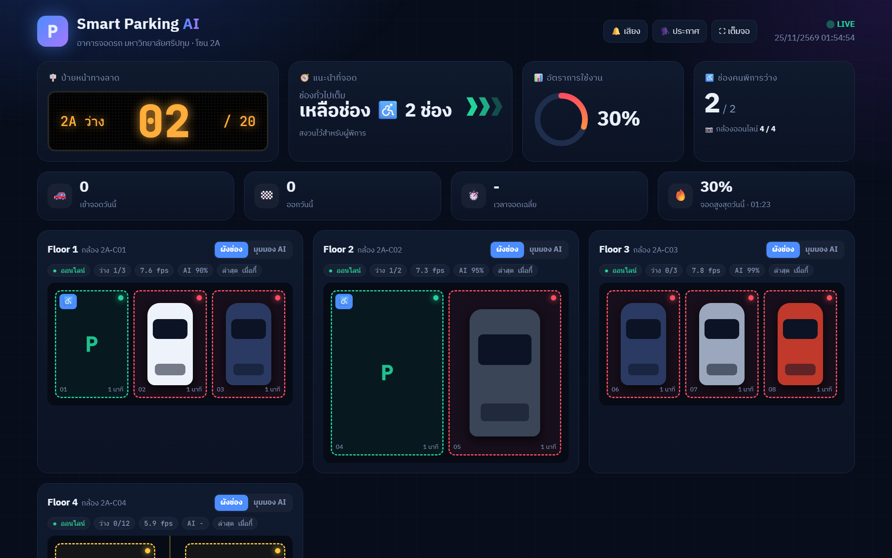
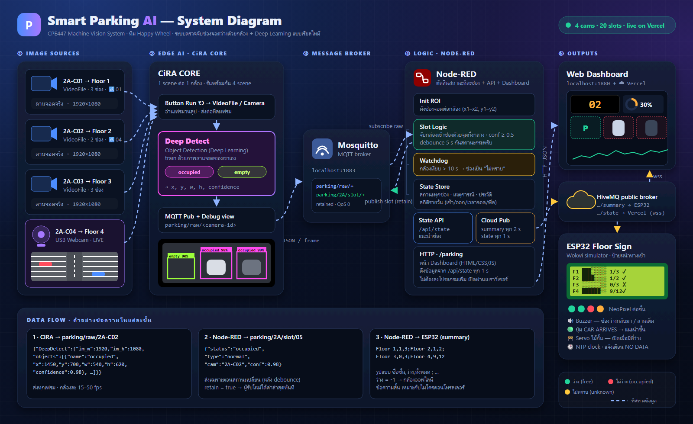
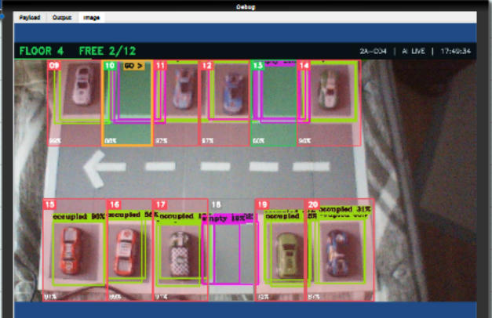
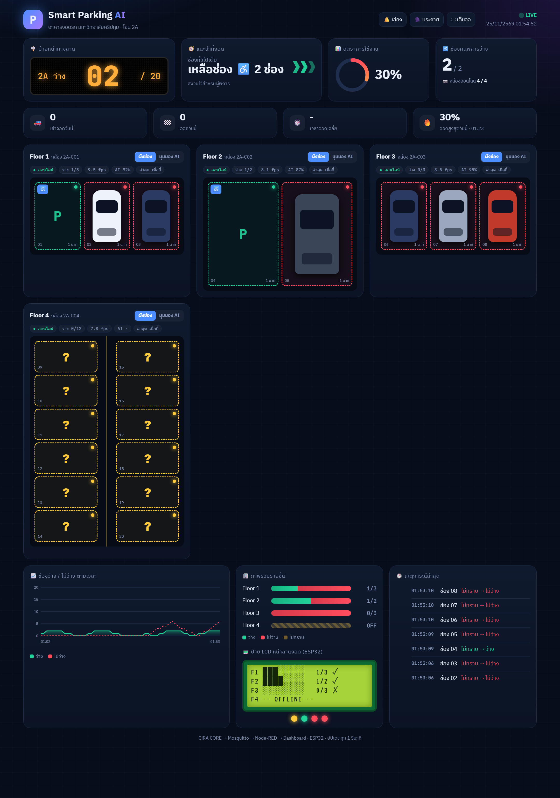

<div align="center">

# 🅿️ Smart Parking AI

**ระบบตรวจจับช่องจอดว่างแบบเรียลไทม์ด้วยกล้อง + Deep Learning**
CPE447 Machine Vision System · Final Project · ทีม **Happy Wheel**

`CiRA CORE` → `MQTT (Mosquitto)` → `Node-RED` → `Web Dashboard` + `ESP32 Floor Sign`



</div>

---

## 🔗 ลิงก์ผลงาน

| | |
|---|---|
| 🌐 Live Dashboard (Vercel) | https://smart-parking-ai-eight.vercel.app |
| 🗺️ System Diagram | [docs/images/system-diagram.png](docs/images/system-diagram.png) |
| 🎤 เอกสารนำเสนอ (Canva) | _[ลิงก์ Canva]_ |
| 🎬 วิดีโอนำเสนอ 3 นาที | _[ลิงก์วิดีโอ]_ |

## ✨ ภาพรวม

อาคารจอดรถส่วนใหญ่ใช้เซนเซอร์ติดทีละช่อง ซึ่งแพงและติดตั้งยาก โปรเจคนี้ใช้ **กล้อง 1 ตัวดูได้หลายช่อง**
โมเดล Object Detection ที่เรา train เองใน **CiRA CORE** แยกแต่ละช่องเป็น `occupied` / `empty`
จากนั้น Node-RED จะจับกล่องที่ตรวจเจอเข้ากับผังช่องจอด (ROI) กรองสัญญาณรบกวน แล้วส่งสถานะไปแสดงผลบน Dashboard และป้ายไฟหน้าลานจอด

| | |
|---|---|
| 📷 **4 กล้อง / 20 ช่อง** | วิดีโอลานจอดจริง 3 กล้อง + เว็บแคมจับโมเดลลานจอดจำลอง 1 กล้อง |
| 🧠 **Edge AI** | Deep Detect ใน CiRA CORE (2 คลาส: occupied / empty) |
| ⚡ **เรียลไทม์** | อัปเดต Dashboard ทุก 1 วินาที, ป้าย LCD ทุก 2 วินาที |
| 🛡️ **ทนทาน** | debounce 5 วินาที, watchdog กล้องหลุด → "ไม่ทราบ" แทนการเดา |
| 🧭 **นำทาง** | แนะนำชั้นและช่องที่ควรไปจอด ทั้งบนเว็บและป้าย ESP32 |

## 🗺️ System Diagram



> ไฟล์ต้นฉบับแบบเวกเตอร์: [`docs/system-diagram.svg`](docs/system-diagram.svg)

## 🧩 องค์ประกอบ

### ① แหล่งภาพ
| กล้อง | แหล่งภาพ | ชั้น | ช่อง |
|---|---|---|---|
| `2A-C01` | VideoFile (ลานจอดจริง) | Floor 1 | 01 ♿, 02, 03 |
| `2A-C02` | VideoFile (ลานจอดจริง) | Floor 2 | 04 ♿, 05 |
| `2A-C03` | VideoFile (ลานจอดจริง) | Floor 3 | 06, 07, 08 |
| `2A-C04` | USB Webcam → โมเดลลานจอดจำลอง | Floor 4 | 09–20 (2 แถว × 6) |

### ② CiRA CORE — [`cira-core/`](cira-core)
- `smart-parking-flow.npj` — 1 scene ต่อ 1 กล้อง: `Button Run → VideoFile/Camera → Deep Detect → MQTT Pub (+ Debug)`
- `train.npj` — flow สำหรับ train โมเดล
- MQTT Pub → `127.0.0.1:1883` topic `parking/raw/<camera-id>`
- `smart-parking-flow-overlay.npj` — flow เดียวกัน + กล่อง **PythonScript** ทุก scene: `DeepDetect → PythonScript → Debug` (สาย `DeepDetect → MqttPub` เหมือนเดิม)
- `overlay_slots.py` — โค้ดในกล่อง PythonScript วาดผังช่องจอด (ROI ชุดเดียวกับ Node-RED) ทับวิดีโอ: เขียว = ว่าง, แดง = ไม่ว่าง, เทา = ไม่แน่ใจ, น้ำเงิน = ช่องคนพิการว่าง (ไม่แนะนำให้คนทั่วไป), กรอบส้ม + `GO >` = ช่องที่แนะนำ (เฉพาะช่องธรรมดา), แถบบน = ชั้น · ว่าง x/y · PWD x/y
  > CiRA CORE 1.9.4: เปิดไฟล์ด้วยการเปิดโปรแกรมใหม่ (อย่าใช้ Open Project ซ้ำในหน้าต่างเดิม → segfault) และห้ามเขียนค่ากลับเข้า `payload` จากกล่องนี้

  

> ⚠️ ไฟล์วิดีโอ, dataset และไฟล์โมเดลที่ train แล้วไม่ได้อยู่ใน repo เพราะขนาดใหญ่ ต้องแก้ path ในไฟล์ `.npj` ให้ตรงกับเครื่องที่ใช้

### ③ MQTT Broker
- **Mosquitto** `localhost:1883` — ข้อมูลภายในระบบ (`parking/raw/+`, `parking/2A/slot/+` แบบ retained)
- **HiveMQ public** — ส่งสรุปไปยัง ESP32 (`cpe447-happywheel-7f3a/parking/summary`) และสถานะทั้งระบบไปยังหน้าเว็บบน Vercel (`cpe447-happywheel-7f3a/parking/state`, retained, ทุก 1 s, ผ่าน `wss://broker.hivemq.com:8884/mqtt`)

### ④ Node-RED — [`node-red/smart-parking-flow.json`](node-red/smart-parking-flow.json)
| Node | หน้าที่ |
|---|---|
| **Init ROI** | ผังช่องจอดต่อกล้อง: ช่วง `x1–x2` (และ `y1–y2` สำหรับกล้องมุมบน) เป็นสัดส่วนของภาพ |
| **Slot Logic** | จับกล่องเข้าช่องด้วยจุดกึ่งกลาง, ใช้ confidence สูงสุดต่อคลาส, เกณฑ์ ≥ 0.5, debounce 5 s |
| **Watchdog** | กล้องเงียบ > 10 s → ทุกช่องของกล้องนั้นเป็น `unknown` |
| **State Store** | เก็บสถานะทุกช่อง, เหตุการณ์, ประวัติ, สถิติรายวัน |
| **State API** | `GET /api/state` → JSON สำหรับ Dashboard (+ ช่องที่แนะนำ, สุขภาพกล้อง, กล่องตรวจจับ) |
| **Dashboard** | `GET /parking` → หน้าเว็บ |
| **Summary** | ทุก 2 s ส่ง `Floor 1,1,2;Floor 2,0,1;…` (นับเฉพาะช่องธรรมดา ไม่รวมช่องคนพิการ) ไปยัง ESP32 |

### ⑤ Web Dashboard — `http://localhost:1880/parking`
- ป้ายไฟ LED จำนวนช่องว่าง (กะพริบ **FULL** เมื่อเต็ม)
- 🧭 แนะนำชั้น/ช่องที่ควรไป + ช่องที่แนะนำเรืองแสงบนผัง
- ผังช่องจอดแบบแอนิเมชัน (รถเลื่อนเข้า-ออก) + เวลาที่จอด
- 🤖 **มุมมอง AI** — วาดกล่องที่โมเดลตรวจเจอทับผัง ROI ของแต่ละกล้อง
- สุขภาพกล้อง: fps, ความมั่นใจเฉลี่ย, ข้อมูลล่าสุด
- สถิติวันนี้: เข้า / ออก / เวลาจอดเฉลี่ย / ช่วงพีค
- กราฟช่องว่าง-ไม่ว่างตามเวลา, ภาพรวมรายชั้น, เหตุการณ์ล่าสุด
- 🔔 เสียงแจ้งเตือน, 🗣️ ประกาศเสียงภาษาไทย, ⛶ โหมดเต็มจอสำหรับป้ายประกาศ
- จำลองหน้าจอ LCD ของ ESP32



### ⑥ ESP32 Floor Sign — [`esp32-sign/`](esp32-sign) (PlatformIO + Wokwi)
| อุปกรณ์ | ขา | หน้าที่ |
|---|---|---|
| LCD 20×4 I2C | SDA 21 / SCL 22 | หน้ารายชั้น (กราฟแท่ง + ✓/✗) สลับกับหน้านำทาง (ลูกศรวิ่ง + ตัวหนังสือเลื่อน) |
| NeoPixel × 4 | 13 | สีต่อชั้น: เขียว = ว่างเยอะ, ส้ม = ใกล้เต็ม, แดง = เต็ม, ม่วง = ออฟไลน์ |
| Buzzer | 25 | เสียงเมื่อมีช่องว่างกลับมา / ลานเต็ม / สัญญาณหาย |
| ปุ่ม CAR ARRIVES | 4 | จำลองรถมาถึงทางเข้า → แนะนำชั้น |
| Servo | 18 | ไม้กั้นทางเข้า เปิดเมื่อมีที่ว่าง |

ส่ง LCD เฉพาะตัวอักษรที่เปลี่ยน (frame buffer) เพื่อลดการรับส่งบนบัส I2C และป้องกันตัวอักษรเพี้ยน

## 🚀 วิธีรัน

1. **Mosquitto** — ติดตั้งและรันเป็น service (พอร์ต 1883)
2. **Node-RED**
   ```bash
   npm install -g node-red
   node-red
   ```
   เปิด `http://localhost:1880` → Menu → Import → เลือก `node-red/smart-parking-flow.json` → Deploy
   (ต้องติดตั้ง `node-red-dashboard` ด้วย ถ้าจะใช้หน้า `/ui`)
3. **CiRA CORE** — เปิด `cira-core/smart-parking-flow.npj` แก้ path วิดีโอ/โมเดล แล้วกด Run ทุก scene
4. **Dashboard** — เปิด `http://localhost:1880/parking`
   หรือเปิดเวอร์ชันออนไลน์ https://smart-parking-ai-eight.vercel.app (ต้องรัน Node-RED อยู่)
5. **ESP32** — เปิดโฟลเดอร์ `esp32-sign/` ใน VS Code (PlatformIO + Wokwi) → Build → `Wokwi: Start Simulator`

### เพิ่มกล้อง / แก้ผังช่องจอด
แก้ที่ node **Init ROI** ที่เดียว:
```js
"2A-C04": [
  {id: "09", x1: 0.00, x2: 0.40, y1: 0.13, y2: 0.25, type: "normal"},
  ...
]
```
แล้วตั้ง CiRA MQTT Pub ให้ส่งไปที่ `parking/raw/2A-C04`

## 📁 โครงสร้าง

```
smart-parking-ai/
├── cira-core/          # CiRA CORE flows (.npj)
├── node-red/           # Node-RED flow (Smart Parking tab)
├── web/               # Dashboard เวอร์ชัน Cloud (Vercel, รับข้อมูลผ่าน HiveMQ wss)
├── esp32-sign/         # PlatformIO + Wokwi project (ESP32 floor sign)
│   ├── src/main.cpp
│   ├── diagram.json
│   └── platformio.ini
└── docs/
    ├── system-diagram.svg
    └── images/
```

## 👥 ทีม Happy Wheel

| รหัสนักศึกษา | ชื่อ–นามสกุล | Section | หน้าที่ |
|---|---|---|---|
| _xxxxxxxxxx_ | _ชื่อ นามสกุล_ | _x_ | **AI & Dataset** — เก็บและ label ภาพ, train Deep Detect, สร้าง scene ใน CiRA CORE |
| _xxxxxxxxxx_ | _ชื่อ นามสกุล_ | _x_ | **Backend** — Mosquitto, Node-RED: ROI, Slot Logic, debounce, watchdog, State API |
| _xxxxxxxxxx_ | _ชื่อ นามสกุล_ | _x_ | **Frontend & Docs** — Web Dashboard, System Diagram, สไลด์และวิดีโอนำเสนอ |
| _xxxxxxxxxx_ | _ชื่อ นามสกุล_ | _x_ | **Hardware** — ESP32 + Wokwi, โมเดลลานจอดจำลอง, เว็บแคมกล้องที่ 4, GitHub |

---

<div align="center">CPE447 Machine Vision System · Sripatum University · 2569</div>
